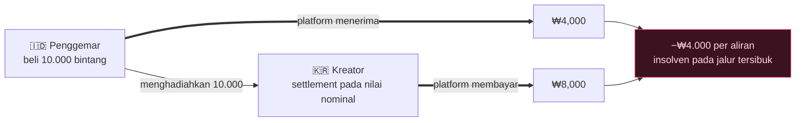
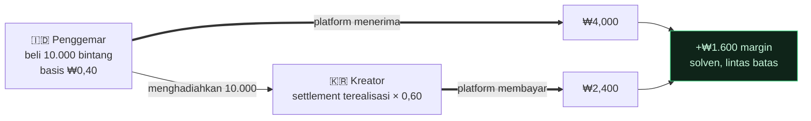

[🇺🇸 English](README.md) · [🇰🇷 한국어](README.ko.md) · [🇯🇵 日本語](README.ja.md) · [🇨🇳 简体中文](README.zh.md) · [🇹🇼 繁體中文](README.zh-TW.md) · [🇹🇭 ไทย](README.th.md) · [🇮🇩 Bahasa](README.id.md) · [🇻🇳 Tiếng Việt](README.vi.md)

# Gift Economy Settlement

**Bagaimana jika sebuah hadiah yang dibeli seharga $0,30 di Jakarta dan dicairkan oleh seorang kreator di Seoul tidak pernah menghabiskan uang Anda sepeser pun?**

> Digunakan oleh [**NSKit**](https://github.com/nskit-io/nskit-io) — *terikat oleh struktur, bebas untuk dikombinasikan.* Ini adalah model settlement yang dirancang untuk **byeol** (belum digunakan di produksi), sebuah platform live‑streaming global tempat penggemar di pasar berkembang mendukung kreator di seluruh dunia.

> Jual mata uang Anda dengan harga lokal. Bayar kreator dari pendapatan nyata. Tetap solven melintasi setiap perbatasan.

**Gift Economy Settlement** adalah sebuah pola desain — beserta implementasi referensinya — untuk model keuangan dari platform mana pun yang menjual mata uang virtual secara global dan membayar kreator darinya: tip live‑streaming, hadiah dari penggemar, mata uang dalam game, pembayaran kreator. Ini bukan sebuah library. Ini adalah pola yang bisa Anda porting ke stack mana pun.

---

## Daftar Isi

- [Jebakan: murah masuk, mahal keluar](#jebakan-murah-masuk-mahal-keluar)
- [Mengapa solusi yang tampak jelas justru bangkrut](#mengapa-solusi-yang-tampak-jelas-justru-bangkrut)
- [Model: settlement berbasis nilai terealisasi](#model-settlement-berbasis-nilai-terealisasi)
- [Solvensi, terbukti](#solvensi-terbukti)
- [Dua mata uang: berbayar dan gratis](#dua-mata-uang-berbayar-dan-gratis)
- [Transparansi: buku besar FIFO](#transparansi-buku-besar-fifo)
- [Kode referensi](#kode-referensi)
- [Trade‑off & kapan digunakan](#trade-off--kapan-digunakan)
- [Tautan](#tautan)

---

## Jebakan: murah masuk, mahal keluar

Setiap platform hadiah menjual mata uang virtual — bintang, koin, permata — yang dibelanjakan penggemar untuk mendukung kreator, dan kreator mencairkannya. Menjadi global, dan dua kekuatan pun berbenturan.

**1. Purchasing‑power parity (PPP).** Untuk memenangkan pengguna di pasar berkembang, mata uang tersebut harus *murah di sana*. Sebuah bintang yang dijual seharga $0,01 di AS tidak bisa dijual seharga $0,01 di Indonesia — tidak ada yang membelinya. App store mendukung harga per‑wilayah justru karena alasan ini, dan Anda harus memanfaatkannya.

**2. Pembayaran kreator.** Kreator mengharapkan *uang tunai yang berarti* atas mata uang yang mereka terima.

Sekarang, jika Anda melakukan settlement pembayaran kreator berdasarkan **nilai nominal** mata uang (1 bintang = 1 unit) sementara menjual bintang itu dengan harga yang disesuaikan PPP, maka aliran lintas batas diam‑diam akan menguras Anda hingga kering.

Dan dalam struktur yang paling penting — fandom global, K‑content, audiens diaspora — aliran yang berbahaya bukanlah pengecualian, melainkan **norma**:

> **Kreator berkumpul di negara berbiaya tinggi. Penggemar berkumpul di negara berbiaya rendah.**

Seorang penggemar membeli bintang dengan murah di Jakarta dan menghadiahkannya kepada seorang kreator di Seoul yang mencairkannya pada nilai nominal Seoul. Anda menerima sedikit dan membayar banyak — pada jalur tersibuk Anda.

## Mengapa solusi yang tampak jelas justru bangkrut

**Settlement nilai nominal yang datar.** Bayar `stars × fixed_rate`. Murah masuk, mahal keluar ⇒ rugi pada aliran yang dominan. Insolven pada skala besar.

**Settlement berdasarkan pasar kreator.** Menggoda — tetapi seorang kreator tidak bisa mengontrol di mana para donornya membeli. Pasar penggemar ≠ pasar kreator, sehingga pembayaran terpisah dari uang yang sesungguhnya masuk. Tetap insolven.



Bug-nya ada pada premisnya: **bahwa sebuah bintang memiliki satu nilai global.** Tidak begitu.

## Model: settlement berbasis nilai terealisasi

Perlakukan nilai nominal mata uang sebagai **fiksi tampilan**. Lakukan settlement berdasarkan uang yang sesungguhnya diterima.

1. **Setiap pembelian mencatat pendapatan terealisasi** — apa yang sesungguhnya diperoleh platform setelah biaya store/PG, pada harga PPP lokal.
2. **Setiap dompet membawa cost‑basis campuran** — mata uang terealisasi per unit yang dimiliki (`netReceived / unitsGranted`, dirata‑ratakan).
3. **Mata uang gratis/bonus memiliki cost‑basis `0`** — karena tidak pernah dibayar, maka tidak pernah di-settle. Tanpa kebocoran. (Lihat [dua mata uang](#dua-mata-uang-berbayar-dan-gratis).)
4. **Sebuah hadiah mentransfer cost‑basis** dari dompet penggemar ke buku besar akrual kreator.
5. **Settlement = Σ(unit berbayar yang diterima × cost‑basis-nya) × rasio pembayaran.**

Pembayaran kreator kini mengikuti *nilai nyata dari dukungan yang mereka terima* — bukan sebuah angka nominal. Seorang kreator di Seoul dengan penggemar di Jakarta dibayar dari pendapatan terealisasi Jakarta.

## Solvensi, terbukti

Misalkan $R$ = total pendapatan terealisasi yang tersimpan dan $p$ = rasio pembayaran, dengan $0 < p < 1$.

$$\text{platform margin} \;=\; R - R\cdot p \;=\; R\,(1-p) \;\ge\; 0$$

Karena pembayaran adalah sebagian **dari pendapatan terealisasi** (bukan dari nilai nominal), platform solven secara konstruksi — **terlepas dari selisih PPP atau bauran lintas batas.** Aliran K‑wave yang berbahaya itu kini menghasilkan positif:



Aliran yang sama yang membangkrutkan model‑model naif kini justru menghasilkan margin.

## Dua mata uang: berbayar dan gratis

Pisahkan mata uang menjadi **berbayar** (dibeli, membawa cost‑basis) dan **gratis** (bonus/event, cost‑basis `0`). Belanjakan yang gratis dulu, yang berbayar kemudian.

- Mata uang gratis memungkinkan Anda menjalankan bonus yang murah hati dan retensi tanpa pernah menciptakan kewajiban settlement — sebuah unit gratis yang dihadiahkan memang secara desain tidak bisa dicairkan.
- Hanya porsi berbayar dari sebuah hadiah yang terakumulasi ke saldo kreator yang dapat di-settle. Pemisahan ini muncul secara otomatis dari perhitungan cost‑basis untuk yang gratis (`0`).

## Transparansi: buku besar FIFO

Akrual menumpuk berdasarkan urutan waktu. Sebuah pembayaran mengonsumsi **akrual tertua lebih dulu (FIFO)**. Tampilkan buku besar itu kepada kreator: untuk setiap penarikan, mereka melihat persis hadiah mana saja yang menyusunnya beserta nilai terealisasi masing‑masing.

| Kapan | Dari | Bintang berbayar | Pembayaran |
|---|---|--:|--:|
| 07‑18 | @stella | 5,000 | ₩4,000 |
| 07‑19 | @captain | 12,000 | ₩9,600 |
| 07‑20 | @onedayfan | 3,000 | ₩2,400 |
| 07‑21 | @lastcall | 8,000 | ₩6,400 |
| | | | **₩22,400** ✓ = total pembayaran |

Kepercayaan adalah sebuah fitur. "Anda menerima 100.000 bintang, inilah persisnya bagaimana itu menjadi uang tunai" lebih baik daripada satu angka tunggal yang tidak transparan.

## Kode referensi

TypeScript yang agnostik-framework di [`src/`](src/) — tanpa dependensi, porting ke mana pun.

```ts
import { Wallet, SettlementEngine } from "./src";

// Sebuah pasar menjual bintang pada harga yang disesuaikan PPP; platform menyimpan KRW terealisasi.
const fan = new Wallet();
fan.credit(10_000, /* realizedKrw */ 4_000);   // cost-basis 0,40/bintang (Indonesia)
fan.creditFree(2_000);                          // bonus — cost-basis 0

const engine = new SettlementEngine({ payoutRatio: 0.60 });
const gift = fan.spend(6_000);                  // gratis dulu, lalu berbayar
engine.accrue(creatorId, gift);                 // hanya porsi berbayar, pada basis-nya

const quote = engine.available(creatorId);      // terealisasi × rasio — selalu ≤ terealisasi
const ledger = engine.ledger(creatorId);        // rincian FIFO, cocok dengan quote
```

Jalankan skenario K‑wave yang telah dikerjakan dan uji solvensi:

```bash
npm install && npm test        # memastikan platform margin ≥ 0 di seluruh aliran lintas batas acak
npx tsx examples/k-wave.ts     # mencetak aliran Jakarta → Seoul
```

## Trade‑off & kapan digunakan

- **Pembayaran kreator bervariasi sesuai bauran donor** — seorang kreator dengan penggemar bernilai tinggi memperoleh lebih banyak per bintang dibanding yang penggemarnya dari pasar berkembang. Ini adalah sebuah fitur: *penghasilan mencerminkan nilai sebenarnya dari dukungan.* Buatlah transparan (buku besar FIFO) agar terbaca adil, bukan sewenang‑wenang.
- **Subsidi tahap pertumbuhan adalah tuas, bukan default.** Anda *boleh* memilih menambah pembayaran pasar berkembang untuk menyemai sebuah pasar — tetapi lakukan sebagai biaya yang eksplisit dan teranggarkan, bukan secara tidak sengaja melalui settlement nilai nominal.
- **PPP adalah urusan data, bukan kode.** Simpan pengali per‑pasar dan ketersediaan store sebagai tabel kelas‑satu yang bisa Anda sesuaikan tanpa deploy.
- **Gunakan ini ketika** Anda menjual satu mata uang lintas pasar dengan daya beli yang berbeda dan membayar kreator darinya. **Lewati ini ketika** Anda beroperasi di satu pasar saja, atau kreator dibayar langsung oleh Anda (bukan dari kumpulan dana yang fungible).

## Tautan

- [**NSKit**](https://github.com/nskit-io/nskit-io) — platform yang ditenagai oleh pola ini
- Dibangun oleh [Neoulsoft Inc.](https://neoulsoft.com) — Seoul, est. 2019

## Lisensi

MIT © Neoulsoft Inc. Lihat [LICENSE](LICENSE).
