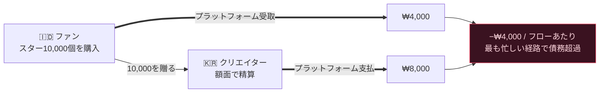
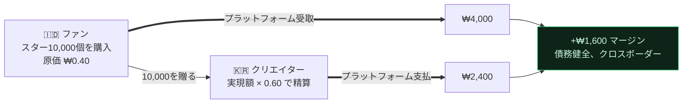

[🇺🇸 English](README.md) · [🇰🇷 한국어](README.ko.md) · [🇯🇵 日本語](README.ja.md) · [🇨🇳 简体中文](README.zh.md) · [🇹🇼 繁體中文](README.zh-TW.md) · [🇹🇭 ไทย](README.th.md) · [🇮🇩 Bahasa](README.id.md) · [🇻🇳 Tiếng Việt](README.vi.md)

# Gift Economy Settlement

**ジャカルタで0.30ドルで買われたギフトを、ソウルのクリエイターが換金しても、あなたには1円もかからないとしたら?**

> [**NSKit**](https://github.com/nskit-io/nskit-io) で採用 — *構造に縛られ、組み合わせは自由に。* これは **byeol** を支える精算モデルであり、新興市場のファンが世界中のクリエイターを支援するグローバルなライブ配信プラットフォームです。

> あなたの通貨を現地価格で販売する。実収益からクリエイターに支払う。あらゆる国境を越えて支払能力を保つ。

**Gift Economy Settlement** は、仮想通貨をグローバルに販売し、そこからクリエイターに支払うあらゆるプラットフォームの資金モデルのための設計パターンであり、リファレンス実装を伴います。対象はライブ配信のチップ、ファンギフティング、ゲーム内通貨、クリエイター報酬など。これはライブラリではありません。あらゆるスタックに移植できるパターンです。

---

## 目次

- [罠：安く入り、高く出る](#罠安く入り高く出る)
- [なぜ当たり前の対処法は破綻するのか](#なぜ当たり前の対処法は破綻するのか)
- [モデル：実現価値ベースの精算](#モデル実現価値ベースの精算)
- [支払能力の証明](#支払能力の証明)
- [2つの通貨：有償と無償](#2つの通貨有償と無償)
- [透明性：FIFO台帳](#透明性fifo台帳)
- [リファレンスコード](#リファレンスコード)
- [トレードオフと使いどころ](#トレードオフと使いどころ)
- [リンク](#リンク)

---

## 罠：安く入り、高く出る

あらゆるギフティングプラットフォームは仮想通貨 — スター、コイン、ジェム — を販売し、ファンはそれを使ってクリエイターを支援し、クリエイターはそれを換金します。グローバルに展開すると、2つの力がぶつかり合います。

**1. 購買力平価（PPP）。** 新興市場でユーザーを獲得するには、その通貨は *現地で安く* なければなりません。米国で0.01ドルで売れるスターを、インドネシアで0.01ドルでは売れません — 誰も買わないのです。アプリストアがまさにこの理由で地域別価格をサポートしており、あなたはそれを使わなければなりません。

**2. クリエイター報酬。** クリエイターは、受け取った通貨に対して *意味のある現金* を期待します。

さて、そのスターをPPP調整済みの価格で販売しながら、クリエイター報酬を通貨の **額面**（1スター = 1単位）で精算すると、国境を越える資金の流れが静かにあなたを出血させていきます。

そして最も重要な構造 — グローバルなファンダム、Kコンテンツ、ディアスポラのオーディエンス — において、危険な流れは例外ではなく **常態** です:

> **クリエイターは高コストの国に集中する。ファンは低コストの国に集中する。**

ファンはジャカルタでスターを安く買い、それをソウルのクリエイターに贈り、そのクリエイターはソウルの額面で換金します。あなたはわずかしか回収せず、多額を支払った — 最も忙しい経路で。

## なぜ当たり前の対処法は破綻するのか

**一律の額面精算。** `stars × fixed_rate` で支払う。安く入り高く出る ⇒ 支配的な流れで損失。スケールすれば支払不能。

**クリエイターの市場で精算する。** 魅力的ですが — クリエイターは支援者がどこで購入したかを制御できません。ファンの市場 ≠ クリエイターの市場なので、報酬は実際に入ってきた資金から切り離されます。それでも支払不能。



バグは前提そのものにあります: **スターがグローバルに一つの価値を持つ、という前提。** そうではありません。

## モデル：実現価値ベースの精算

通貨の額面を **表示上のフィクション** として扱いましょう。実際に受け取った資金に基づいて精算します。

1. **すべての購入が実現収益を記録する** — 現地のPPP価格で、ストア/PG手数料を差し引いた後にプラットフォームが実際に手にした額。
2. **各ウォレットはブレンドされた原価基準を持つ** — 保有する1単位あたりの実現通貨（`netReceived / unitsGranted` の平均）。
3. **無償/ボーナス通貨は原価基準が `0`** — 対価が支払われていないので、決して精算されません。漏れなし。（[2つの通貨](#2つの通貨有償と無償)を参照。）
4. **ギフトは原価基準を移転する** — ファンのウォレットからクリエイターの発生台帳へ。
5. **精算 = Σ(受け取った有償単位 × その原価基準) × 支払比率。**

クリエイターの報酬は、額面の数字ではなく *受け取った支援の本当の価値* を追跡するようになります。ジャカルタのファンを持つソウルのクリエイターは、ジャカルタで実現した収益から支払われます。

## 支払能力の証明

$R$ を積み立てた実現収益の総額、$p$ を支払比率（$0 < p < 1$）とする。

$$\text{platform margin} \;=\; R - R\cdot p \;=\; R\,(1-p) \;\ge\; 0$$

支払いは（額面ではなく）**実現収益** の一部であるため、プラットフォームは構造上支払能力を保ちます — **PPPの差やクロスボーダーの構成比にかかわらず。** 危険なK-wave の流れも今やプラスに転じます:



素朴なモデルを破綻させたのと同じ流れが、今やマージンを生み出します。

## 2つの通貨：有償と無償

通貨を **有償**（購入され、原価基準を持つ）と **無償**（ボーナス/イベント、原価基準 `0`）に分けます。無償を先に、有償を後に消費します。

- 無償通貨によって、精算負債を一切生み出すことなく、気前のよいボーナスやリテンション施策を実行できます — 贈られた無償単位は設計上、換金不能です。
- ギフトのうち有償部分だけがクリエイターの精算可能残高に発生します。この分割は、無償の原価基準（`0`）の計算から自動的に導かれます。

## 透明性：FIFO台帳

発生分は時間順に積み重なります。支払いは **最も古い発生分から順に（FIFO）** 消費します。その台帳をクリエイターに公開しましょう: どの引き出しについても、それを構成するギフトと各々の実現価値を正確に見ることができます。

| 日時 | 差出人 | 有償スター | 支払額 |
|---|---|--:|--:|
| 07‑18 | @stella | 5,000 | ₩4,000 |
| 07‑19 | @captain | 12,000 | ₩9,600 |
| 07‑20 | @onedayfan | 3,000 | ₩2,400 |
| 07‑21 | @lastcall | 8,000 | ₩6,400 |
| | | | **₩22,400** ✓ = 支払合計 |

信頼は機能です。「あなたは100,000スターを受け取りました。それがどのように現金になるか、正確にこちらです」は、不透明な一つの数字に勝ります。

## リファレンスコード

[`src/`](src/) にフレームワーク非依存の TypeScript — 依存関係なし、どこにでも移植できます。

```ts
import { Wallet, SettlementEngine } from "./src";

// ある市場ではPPP調整済みの価格でスターを販売し、プラットフォームは実現したKRWを積み立てる。
const fan = new Wallet();
fan.credit(10_000, /* realizedKrw */ 4_000);   // 原価基準 0.40/スター（インドネシア）
fan.creditFree(2_000);                          // ボーナス — 原価基準 0

const engine = new SettlementEngine({ payoutRatio: 0.60 });
const gift = fan.spend(6_000);                  // 無償を先に、次に有償
engine.accrue(creatorId, gift);                 // 有償部分のみ、その原価基準で

const quote = engine.available(creatorId);      // 実現額 × 比率 — 常に ≤ 実現額
const ledger = engine.ledger(creatorId);        // FIFOの内訳、quoteと整合する
```

作り込んだK-waveシナリオと支払能力テストを実行:

```bash
npm install && npm test        # ランダムなクロスボーダーの流れ全体でプラットフォームマージン ≥ 0 を検証
npx tsx examples/k-wave.ts     # ジャカルタ → ソウル の流れを出力
```

## トレードオフと使いどころ

- **クリエイター報酬は支援者の構成で変動する** — 高価値のファンを持つクリエイターは、新興市場のファンを持つクリエイターよりもスターあたり多く稼ぎます。これは機能です: *報酬は支援の本当の価値を反映する。* 透明にして（FIFO台帳）、恣意的ではなく公正に見えるようにしましょう。
- **成長段階の補助はダイヤルであって、デフォルトではない。** 市場を育てるために新興市場の報酬を上乗せすることを *選択* してもよい — ただしそれは、額面精算を通じて偶発的にではなく、明示的で予算化されたコストとして行いましょう。
- **PPPはコードではなくデータに属する。** 市場別の乗数とストアの提供可否を、デプロイなしで調整できる第一級のテーブルとして保持しましょう。
- **これを使うべきとき**: 購買力の異なる複数の市場で一つの通貨を販売し、そこからクリエイターに支払うとき。**使わないとき**: 単一市場で運営している、またはクリエイターに（代替可能なプールからではなく）あなたが直接支払うとき。

## リンク

- [**NSKit**](https://github.com/nskit-io/nskit-io) — このパターンが支えるプラットフォーム
- [Neoulsoft Inc.](https://neoulsoft.com) が構築 — ソウル、2019年設立

## License

MIT © Neoulsoft Inc. See [LICENSE](LICENSE).
