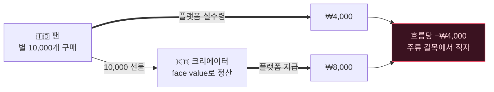
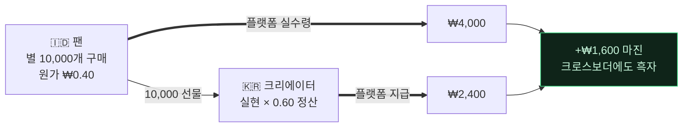

[🇺🇸 English](README.md) · [🇰🇷 한국어](README.ko.md) · [🇯🇵 日本語](README.ja.md) · [🇨🇳 简体中文](README.zh.md) · [🇹🇼 繁體中文](README.zh-TW.md) · [🇹🇭 ไทย](README.th.md) · [🇮🇩 Bahasa](README.id.md) · [🇻🇳 Tiếng Việt](README.vi.md)

# Gift Economy Settlement

**자카르타에서 $0.30에 산 선물을 서울의 크리에이터가 현금화하는데, 플랫폼은 1원도 손해 보지 않는다면?**

> [**NSKit**](https://github.com/nskit-io/nskit-io)에서 사용 — *구조에 묶이되, 조합은 자유롭게.* 이것은 신흥시장 팬이 전 세계 크리에이터를 후원하는 글로벌 라이브 방송 플랫폼 **byeol**을 위해 설계한 정산 모델입니다(아직 운영 적용 전).

> 재화는 현지 가격에 팔고, 크리에이터는 실제 매출에서 지급하며, 모든 국경에서 흑자를 유지한다.

**Gift Economy Settlement**은 가상 재화를 글로벌하게 팔고 그 재화로 크리에이터에게 지급하는 모든 플랫폼(라이브 후원·팬 기프팅·인게임 재화·크리에이터 정산)의 **머니 모델 설계 패턴**이자 레퍼런스 구현입니다. 라이브러리가 아니라, 어떤 스택에도 이식 가능한 패턴입니다.

---

## 목차

- [함정: 싸게 들어와 비싸게 나간다](#함정-싸게-들어와-비싸게-나간다)
- [뻔한 해법이 파산하는 이유](#뻔한-해법이-파산하는-이유)
- [모델: 실현가치 정산](#모델-실현가치-정산)
- [수학적 solvency 증명](#수학적-solvency-증명)
- [두 재화: 유료와 무료](#두-재화-유료와-무료)
- [투명성: FIFO 원장](#투명성-fifo-원장)
- [레퍼런스 코드](#레퍼런스-코드)
- [트레이드오프 · 언제 쓰나](#트레이드오프--언제-쓰나)
- [링크](#링크)

---

## 함정: 싸게 들어와 비싸게 나간다

모든 기프팅 플랫폼은 팬이 크리에이터를 응원하는 데 쓰는 가상 재화(별·코인·젬)를 팔고, 크리에이터는 이를 현금화합니다. 글로벌로 나가면 두 힘이 충돌합니다.

**1. 구매력 평가(PPP).** 신흥시장 유저를 얻으려면 재화가 *그곳에서 싸야* 합니다. 미국에서 $0.01짜리 별을 인도네시아에서 $0.01에 팔면 아무도 안 삽니다. 앱스토어가 국가별 가격을 지원하는 이유고, 반드시 써야 합니다.

**2. 크리에이터 지급.** 크리에이터는 받은 재화에 대해 *의미 있는 현금*을 기대합니다.

이제 재화를 PPP 가격으로 팔면서 크리에이터 지급은 **face value**(1별 = 1원)로 정산하면, 크로스보더 흐름이 조용히 당신을 말려 죽입니다.

그리고 가장 중요한 구조 — 글로벌 팬덤, K‑콘텐츠, 디아스포라 — 에서 위험한 흐름은 예외가 아니라 **주류**입니다:

> **크리에이터는 고물가 국가에, 팬은 저물가 국가에 몰린다.**

팬이 자카르타에서 별을 싸게 사서 서울 크리에이터에게 선물하고, 크리에이터는 서울 face value로 현금화합니다. 적게 받고 많이 지급 — 그것도 가장 붐비는 길목에서.

## 뻔한 해법이 파산하는 이유

**Flat face‑value 정산.** `별 × 고정환율` 지급. 싸게 들어와 비싸게 나감 ⇒ 주류 흐름에서 적자. 규모가 커지면 파산.

**크리에이터 시장 기준 정산.** 솔깃하지만 — 크리에이터는 팬이 어디서 샀는지 통제할 수 없습니다. 팬 시장 ≠ 크리에이터 시장이라, 지급이 실제 들어온 돈과 분리됩니다. 여전히 파산.



버그는 전제에 있습니다: **"별이 전 세계 단일 가치를 갖는다"** 는 것. 아닙니다.

## 모델: 실현가치 정산

재화의 face value를 **표시용 허구**로 두고, 실제 들어온 돈으로 정산합니다.

1. **모든 구매가 실현 매출을 기록** — 스토어/PG 수수료 차감 후, 현지 PPP 가격으로 플랫폼이 실제 받은 돈.
2. **각 지갑이 블렌디드 원가(cost‑basis)를 보유** — 보유 유료 단위당 실현 금액(`실수령 / 지급단위`의 평균).
3. **무료/보너스 재화의 원가는 `0`** — 결제된 적이 없으니 정산되지 않음. 누수 없음. ([두 재화](#두-재화-유료와-무료) 참조.)
4. **선물이 원가를 이전** — 팬 지갑에서 크리에이터 적립 원장으로.
5. **정산 = Σ(받은 유료 단위 × 원가) × 정산비율.**

이제 크리에이터 지급은 face 숫자가 아니라 *받은 지지의 실제 가치*를 따라갑니다. 자카르타 팬을 둔 서울 크리에이터는 자카르타 실현 매출에서 지급받습니다.

## 수학적 solvency 증명

$R$ = 은행에 실제 들어온 실현 매출, $p$ = 정산비율 ($0 < p < 1$).

$$\text{플랫폼 마진} \;=\; R - R\cdot p \;=\; R\,(1-p) \;\ge\; 0$$

지급이 face가 아니라 **실현 매출의 일부**이므로, 플랫폼은 **PPP 격차나 크로스보더 믹스와 무관하게** 구조적으로 흑자입니다. 파산시켰던 K‑wave 흐름이 이제 흑자를 냅니다:



## 두 재화: 유료와 무료

재화를 **유료**(구매, 원가 보유)와 **무료**(보너스/이벤트, 원가 `0`)로 나눕니다. 소비는 무료 먼저, 유료 나중.

- 무료 재화로 관대한 보너스·리텐션을 돌려도 **정산 부채가 절대 생기지 않습니다** — 선물된 무료 단위는 설계상 현금화 불가.
- 선물의 유료 포션만 크리에이터 정산 잔액에 적립됩니다. 유료/무료 분리는 무료의 원가(`0`)에서 자동으로 떨어집니다.

## 투명성: FIFO 원장

적립은 시간 순으로 쌓입니다. 환급은 **오래된 적립부터(FIFO)** 소진합니다. 이 원장을 크리에이터에게 공개하세요 — 어떤 선물이 이번 환급을 구성하고 각각의 실현가치가 얼마인지.

| 시점 | 후원자 | 유료 별 | 지급 |
|---|---|--:|--:|
| 07‑18 | @stella | 5,000 | ₩4,000 |
| 07‑19 | @captain | 12,000 | ₩9,600 |
| 07‑20 | @onedayfan | 3,000 | ₩2,400 |
| 07‑21 | @lastcall | 8,000 | ₩6,400 |
| | | | **₩22,400** ✓ = 환급 총액 |

신뢰가 기능입니다. "10만 별을 받으셨고, 정확히 이렇게 현금이 됩니다"가 불투명한 단일 숫자를 이깁니다.

## 레퍼런스 코드

의존성 없는 프레임워크‑무관 TypeScript가 [`src/`](src/)에 있습니다.

```ts
import { Wallet, SettlementEngine } from "./src";

// 시장은 별을 PPP 가격에 팔고, 플랫폼은 실현 원화를 은행에 담는다.
const fan = new Wallet();
fan.credit(10_000, /* realizedKrw */ 4_000);   // 원가 0.40/별 (인도네시아)
fan.creditFree(2_000);                          // 보너스 — 원가 0

const engine = new SettlementEngine({ payoutRatio: 0.60 });
const gift = fan.spend(6_000);                  // 무료 먼저, 그다음 유료
engine.accrue(creatorId, gift);                 // 유료 포션만, 그 원가로 적립

const quote = engine.available(creatorId);      // 실현 × 비율 — 항상 실현 이하
const ledger = engine.ledger(creatorId);        // FIFO 내역, quote 와 정합
```

K‑wave 시나리오와 solvency 테스트 실행:

```bash
npm install && npm test        # 무작위 크로스보더 흐름에서 플랫폼 마진 ≥ 0 검증
npx tsx examples/k-wave.ts     # 자카르타 → 서울 흐름 출력
```

## 트레이드오프 · 언제 쓰나

- **크리에이터 지급이 팬 구성에 따라 달라집니다** — 고가치 팬을 둔 크리에이터가 별당 더 벌죠. 이건 기능입니다: *수익 = 지지의 실제 가치.* FIFO 원장으로 투명하게 보여주면 자의적이 아니라 공정하게 읽힙니다.
- **성장기 보조금은 기본값이 아니라 다이얼입니다.** 시장 선점을 위해 신흥시장 지급을 얹을 *수* 있지만, face‑value 정산으로 실수로 흘리지 말고 **명시적·예산화된 비용**으로.
- **PPP는 코드가 아니라 데이터에.** 시장별 배수·스토어 접근성을 배포 없이 튜닝하는 1급 테이블로.
- **쓸 때**: 구매력이 다른 여러 시장에 하나의 재화를 팔고 그 재화로 크리에이터에게 지급할 때. **안 쓸 때**: 단일 시장이거나, 크리에이터를 fungible 풀이 아니라 직접 지급할 때.

## 링크

- [**NSKit**](https://github.com/nskit-io/nskit-io) — 이 패턴이 구동하는 플랫폼
- [주식회사 너울소프트](https://neoulsoft.com) — 서울, 2019 설립

## 라이선스

MIT © Neoulsoft Inc. [LICENSE](LICENSE) 참조.
