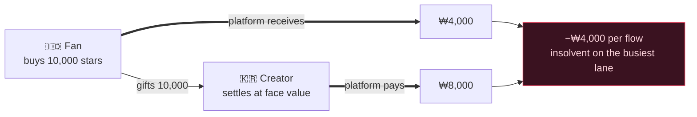
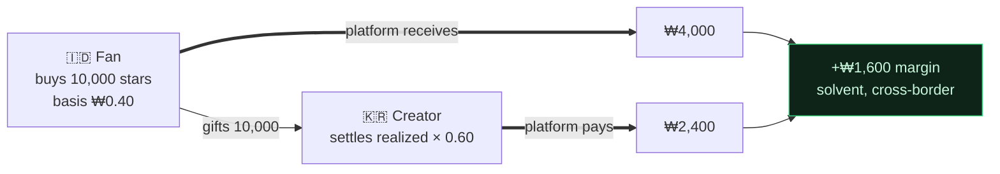

[🇰🇷 한국어](README.ko.md)

# Gift Economy Settlement

**What if a gift bought for $0.30 in Jakarta and cashed out by a creator in Seoul never cost you a cent?**

> Used by [**NSKit**](https://github.com/nskit-io/nskit-io) — *bound by structure, free to combine.* This is the settlement model behind **byeol**, a global live‑streaming platform where fans in emerging markets support creators worldwide.

> Sell your currency at local prices. Pay creators from real revenue. Stay solvent across every border.

**Gift Economy Settlement** is a design pattern — with a reference implementation — for the money model of any platform that sells a virtual currency globally and pays creators out of it: live‑streaming tips, fan gifting, in‑game currency, creator payouts. This is not a library. It is a pattern you can port into any stack.

---

## Table of Contents

- [The trap: cheap in, expensive out](#the-trap-cheap-in-expensive-out)
- [Why the obvious fixes go bankrupt](#why-the-obvious-fixes-go-bankrupt)
- [The model: realized‑value settlement](#the-model-realized-value-settlement)
- [Solvency, proven](#solvency-proven)
- [Two currencies: paid and free](#two-currencies-paid-and-free)
- [Transparency: the FIFO ledger](#transparency-the-fifo-ledger)
- [Reference code](#reference-code)
- [Trade‑offs & when to use](#trade-offs--when-to-use)
- [Links](#links)

---

## The trap: cheap in, expensive out

Every gifting platform sells a virtual currency — stars, coins, gems — that fans spend to support creators, and creators cash out. Go global and two forces collide.

**1. Purchasing‑power parity (PPP).** To win users in emerging markets, the currency must be *cheap there*. A star that sells for $0.01 in the US cannot sell for $0.01 in Indonesia — nobody buys. App stores support per‑territory pricing for exactly this reason, and you must use it.

**2. Creator payout.** Creators expect *meaningful cash* for the currency they receive.

Now settle creator payouts on the currency's **face value** (1 star = 1 unit) while selling that star at PPP‑adjusted prices, and cross‑border flows quietly bleed you dry.

And in the structure that matters most — global fandoms, K‑content, diaspora audiences — the dangerous flow is not the exception, it's **the norm**:

> **Creators cluster in high‑cost countries. Fans cluster in low‑cost countries.**

A fan buys stars cheaply in Jakarta and gifts them to a creator in Seoul who cashes out at Seoul face value. You collected little and paid out a lot — on your busiest lane.

## Why the obvious fixes go bankrupt

**Flat face‑value settlement.** Pay `stars × fixed_rate`. Cheap‑in, expensive‑out ⇒ loss on the dominant flow. Insolvent at scale.

**Settle by the creator's market.** Tempting — but a creator cannot control where their donors bought. Fan market ≠ creator market, so the payout is decoupled from the money that actually came in. Still insolvent.



The bug is the premise: **that a star has one global value.** It doesn't.

## The model: realized‑value settlement

Treat the currency's face value as a **display fiction**. Settle on the money that was actually received.

1. **Every purchase records realized revenue** — what the platform actually netted after store/PG fees, at the local PPP price.
2. **Each wallet carries a blended cost‑basis** — realized currency per unit held (`netReceived / unitsGranted`, averaged).
3. **Free/bonus currency has cost‑basis `0`** — it was never paid for, so it never settles. No leakage. (See [two currencies](#two-currencies-paid-and-free).)
4. **A gift transfers cost‑basis** from the fan's wallet to the creator's accrual ledger.
5. **Settlement = Σ(received paid units × their cost‑basis) × payout ratio.**

The creator's payout now tracks the *real value of the support they received* — not a face number. A Seoul creator with Jakarta fans is paid from Jakarta‑realized revenue.

## Solvency, proven

Let $R$ = total realized revenue banked and $p$ = payout ratio, with $0 < p < 1$.

$$\text{platform margin} \;=\; R - R\cdot p \;=\; R\,(1-p) \;\ge\; 0$$

Because payout is a fraction **of realized revenue** (not of face value), the platform is solvent by construction — **regardless of PPP spread or cross‑border mix.** The dangerous K‑wave flow now nets positive:



Same flow that bankrupted the naive models now earns margin.

## Two currencies: paid and free

Split the currency into **paid** (bought, carries cost‑basis) and **free** (bonus/events, cost‑basis `0`). Spend free‑first, paid‑second.

- Free currency lets you run generous bonuses and retention without ever creating a settlement liability — a gifted free unit is un‑cashable by design.
- Only the paid portion of a gift accrues to a creator's settleable balance. The split falls out of the cost‑basis math for free (`0`) automatically.

## Transparency: the FIFO ledger

Accruals stack in time order. A payout consumes the **oldest accruals first (FIFO)**. Expose that ledger to the creator: for any withdrawal, they see exactly which gifts compose it and the realized value of each.

| When | From | Paid stars | Payout |
|---|---|--:|--:|
| 07‑18 | @stella | 5,000 | ₩4,000 |
| 07‑19 | @captain | 12,000 | ₩9,600 |
| 07‑20 | @onedayfan | 3,000 | ₩2,400 |
| 07‑21 | @lastcall | 8,000 | ₩6,400 |
| | | | **₩22,400** ✓ = payout total |

Trust is a feature. "You received 100,000 stars, here is precisely how it becomes cash" beats a single opaque number.

## Reference code

Framework‑agnostic TypeScript in [`src/`](src/) — no dependencies, port it anywhere.

```ts
import { Wallet, SettlementEngine } from "./src";

// A market sells stars at a PPP‑adjusted price; the platform banks realized KRW.
const fan = new Wallet();
fan.credit(10_000, /* realizedKrw */ 4_000);   // cost-basis 0.40/star (Indonesia)
fan.creditFree(2_000);                          // bonus — cost-basis 0

const engine = new SettlementEngine({ payoutRatio: 0.60 });
const gift = fan.spend(6_000);                  // free-first, then paid
engine.accrue(creatorId, gift);                 // only the paid portion, at its basis

const quote = engine.available(creatorId);      // realized × ratio — always ≤ realized
const ledger = engine.ledger(creatorId);        // FIFO breakdown, reconciles to quote
```

Run the worked K‑wave scenario and the solvency test:

```bash
npm install && npm test        # asserts platform margin ≥ 0 across random cross‑border flows
npx tsx examples/k-wave.ts     # prints the Jakarta → Seoul flow
```

## Trade‑offs & when to use

- **Creator payout varies with donor mix** — a creator with high‑value fans earns more per star than one with emerging‑market fans. This is a feature: *earnings reflect the true value of support.* Make it transparent (the FIFO ledger) so it reads as fair, not arbitrary.
- **Growth‑stage subsidy is a dial, not a default.** You *may* choose to top up emerging‑market payouts to seed a market — but do it as an explicit, budgeted cost, not by accident through face‑value settlement.
- **PPP belongs in data, not code.** Keep per‑market multipliers and store availability as a first‑class table you can tune without a deploy.
- **Use this when** you sell one currency across markets with different purchasing power and pay creators from it. **Skip it when** you operate a single market, or creators are paid by you directly (not from a fungible pool).

## Links

- [**NSKit**](https://github.com/nskit-io/nskit-io) — the platform this pattern powers
- Built by [Neoulsoft Inc.](https://neoulsoft.com) — Seoul, est. 2019

## License

MIT © Neoulsoft Inc. See [LICENSE](LICENSE).
