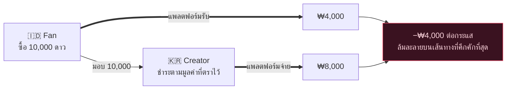
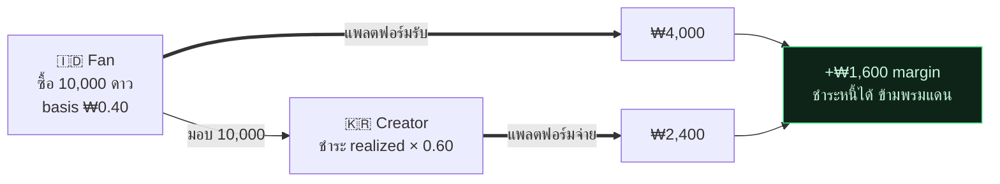

[🇺🇸 English](README.md) · [🇰🇷 한국어](README.ko.md) · [🇯🇵 日本語](README.ja.md) · [🇨🇳 简体中文](README.zh.md) · [🇹🇼 繁體中文](README.zh-TW.md) · [🇹🇭 ไทย](README.th.md) · [🇮🇩 Bahasa](README.id.md) · [🇻🇳 Tiếng Việt](README.vi.md)

# Gift Economy Settlement

**จะเป็นอย่างไรถ้าของขวัญที่ซื้อในราคา $0.30 ที่จาการ์ตาแล้วถูกครีเอเตอร์ในโซลถอนเป็นเงินสด ไม่ทำให้คุณเสียเงินแม้แต่บาทเดียว?**

> ใช้งานโดย [**NSKit**](https://github.com/nskit-io/nskit-io) — *ผูกด้วยโครงสร้าง อิสระในการประกอบ* นี่คือโมเดลการชำระบัญชี (settlement) ที่ออกแบบมาเพื่อ **byeol** (ยังไม่ได้ใช้งานจริงในระบบโปรดักชัน) ซึ่งเป็นแพลตฟอร์มไลฟ์สตรีมมิ่งระดับโลกที่แฟน ๆ ในตลาดเกิดใหม่สนับสนุนครีเอเตอร์ทั่วโลก

> ขายสกุลเงินของคุณในราคาท้องถิ่น จ่ายครีเอเตอร์จากรายได้จริง และคงความสามารถในการชำระหนี้ (solvent) ในทุกพรมแดน

**Gift Economy Settlement** คือดีไซน์แพตเทิร์น — พร้อมกับ reference implementation — สำหรับโมเดลด้านการเงินของแพลตฟอร์มใด ๆ ที่ขายสกุลเงินเสมือนไปทั่วโลกและจ่ายเงินให้ครีเอเตอร์จากสกุลเงินนั้น ได้แก่ ทิปในไลฟ์สตรีม การมอบของขวัญจากแฟน สกุลเงินในเกม การจ่ายเงินให้ครีเอเตอร์ นี่ไม่ใช่ไลบรารี แต่เป็นแพตเทิร์นที่คุณสามารถนำไปใช้กับสแตกใดก็ได้

---

## สารบัญ

- [กับดัก: เข้าถูก ออกแพง](#the-trap-cheap-in-expensive-out)
- [ทำไมวิธีแก้ที่ดูชัดเจนถึงล้มละลาย](#why-the-obvious-fixes-go-bankrupt)
- [โมเดล: การชำระบัญชีตามมูลค่าที่รับรู้จริง (realized‑value settlement)](#the-model-realized-value-settlement)
- [ความสามารถในการชำระหนี้ ที่พิสูจน์ได้](#solvency-proven)
- [สองสกุลเงิน: แบบเสียเงินและแบบฟรี](#two-currencies-paid-and-free)
- [ความโปร่งใส: บัญชีแบบ FIFO](#transparency-the-fifo-ledger)
- [โค้ดอ้างอิง](#reference-code)
- [ข้อแลกเปลี่ยน & เมื่อใดควรใช้](#trade-offs--when-to-use)
- [ลิงก์](#links)

---

## กับดัก: เข้าถูก ออกแพง

ทุกแพลตฟอร์มมอบของขวัญขายสกุลเงินเสมือน — ดาว เหรียญ อัญมณี — ที่แฟน ๆ ใช้จ่ายเพื่อสนับสนุนครีเอเตอร์ และครีเอเตอร์นำไปถอนเป็นเงินสด เมื่อขยายไปทั่วโลก แรงสองอย่างจะปะทะกัน

**1. ความเท่าเทียมของอำนาจซื้อ (Purchasing‑power parity, PPP)** เพื่อชนะใจผู้ใช้ในตลาดเกิดใหม่ สกุลเงินต้อง *ถูกในตลาดนั้น* ดาวที่ขายในราคา $0.01 ในสหรัฐฯ ไม่สามารถขายในราคา $0.01 ในอินโดนีเซียได้ — จะไม่มีใครซื้อ แอปสโตร์รองรับการตั้งราคาแยกตามอาณาเขตด้วยเหตุผลนี้เอง และคุณต้องใช้มัน

**2. การจ่ายเงินให้ครีเอเตอร์** ครีเอเตอร์คาดหวัง *เงินสดที่มีความหมาย* สำหรับสกุลเงินที่พวกเขาได้รับ

ทีนี้ ถ้าคุณชำระเงินให้ครีเอเตอร์ตาม **มูลค่าที่ตราไว้ (face value)** ของสกุลเงิน (1 ดาว = 1 หน่วย) ในขณะที่ขายดาวนั้นในราคาที่ปรับตาม PPP กระแสเงินข้ามพรมแดนจะค่อย ๆ ดูดเลือดคุณจนหมด

และในโครงสร้างที่สำคัญที่สุด — แฟนด้อมระดับโลก, K‑content, กลุ่มผู้ชมพลัดถิ่น — กระแสเงินที่อันตรายไม่ใช่ข้อยกเว้น แต่มันคือ **บรรทัดฐาน**:

> **ครีเอเตอร์กระจุกตัวในประเทศที่มีค่าครองชีพสูง แฟน ๆ กระจุกตัวในประเทศที่มีค่าครองชีพต่ำ**

แฟนคนหนึ่งซื้อดาวราคาถูกในจาการ์ตาแล้วมอบให้ครีเอเตอร์ในโซลที่ถอนเป็นเงินสดตามมูลค่าที่ตราไว้ของโซล คุณเก็บมาได้น้อยแต่จ่ายออกไปมาก — บนเส้นทางที่คึกคักที่สุดของคุณ

## ทำไมวิธีแก้ที่ดูชัดเจนถึงล้มละลาย

**การชำระตามมูลค่าที่ตราไว้แบบคงที่ (Flat face‑value settlement)** จ่าย `stars × fixed_rate` เข้าถูก ออกแพง ⇒ ขาดทุนบนกระแสเงินที่เป็นสัดส่วนหลัก ล้มละลายเมื่อขยายขนาด

**ชำระตามตลาดของครีเอเตอร์** น่าดึงดูดใจ — แต่ครีเอเตอร์ควบคุมไม่ได้ว่าผู้บริจาคของตนซื้อจากที่ไหน ตลาดของแฟน ≠ ตลาดของครีเอเตอร์ ดังนั้นการจ่ายเงินจึงถูกตัดขาดจากเงินที่เข้ามาจริง ก็ยังคงล้มละลายอยู่ดี



จุดบกพร่องอยู่ที่สมมติฐาน: **ที่ว่าดาวมีมูลค่าเดียวทั่วโลก** ซึ่งไม่จริง

## โมเดล: การชำระบัญชีตามมูลค่าที่รับรู้จริง (realized‑value settlement)

จงถือว่ามูลค่าที่ตราไว้ของสกุลเงินเป็น **เรื่องแต่งเพื่อการแสดงผล (display fiction)** แล้วชำระบัญชีตามเงินที่ได้รับมาจริง

1. **ทุกการซื้อบันทึกรายได้ที่รับรู้จริง (realized revenue)** — สิ่งที่แพลตฟอร์มได้สุทธิจริงหลังหักค่าธรรมเนียมสโตร์/PG ที่ราคา PPP ท้องถิ่น
2. **แต่ละกระเป๋าเงินถือ cost‑basis แบบผสม (blended)** — สกุลเงินที่รับรู้จริงต่อหน่วยที่ถืออยู่ (`netReceived / unitsGranted` เฉลี่ย)
3. **สกุลเงินฟรี/โบนัสมี cost‑basis เท่ากับ `0`** — เพราะไม่เคยมีการจ่ายเงินซื้อ จึงไม่มีการชำระบัญชี ไม่มีการรั่วไหล (ดู [สองสกุลเงิน](#two-currencies-paid-and-free))
4. **ของขวัญโอน cost‑basis** จากกระเป๋าเงินของแฟนไปยังบัญชีสะสม (accrual ledger) ของครีเอเตอร์
5. **การชำระบัญชี = Σ(หน่วยแบบเสียเงินที่ได้รับ × cost‑basis ของหน่วยนั้น) × payout ratio**

การจ่ายเงินของครีเอเตอร์ตอนนี้สะท้อน *มูลค่าที่แท้จริงของการสนับสนุนที่พวกเขาได้รับ* — ไม่ใช่ตัวเลขมูลค่าที่ตราไว้ ครีเอเตอร์ในโซลที่มีแฟนในจาการ์ตาจะได้รับเงินจากรายได้ที่รับรู้จริงในจาการ์ตา

## ความสามารถในการชำระหนี้ ที่พิสูจน์ได้

ให้ $R$ = รายได้ที่รับรู้จริงทั้งหมดที่เก็บเข้ามา และ $p$ = payout ratio โดยที่ $0 < p < 1$

$$\text{platform margin} \;=\; R - R\cdot p \;=\; R\,(1-p) \;\ge\; 0$$

เพราะการจ่ายเงินเป็นเศษส่วน **ของรายได้ที่รับรู้จริง** (ไม่ใช่ของมูลค่าที่ตราไว้) แพลตฟอร์มจึงมีความสามารถในการชำระหนี้โดยการออกแบบ — **โดยไม่ขึ้นกับส่วนต่าง PPP หรือสัดส่วนของกระแสข้ามพรมแดน** กระแส K‑wave ที่อันตรายตอนนี้ให้ผลสุทธิเป็นบวก:



กระแสเดียวกันที่เคยทำให้โมเดลไร้เดียงสาล้มละลาย ตอนนี้กลับสร้างกำไร

## สองสกุลเงิน: แบบเสียเงินและแบบฟรี

แบ่งสกุลเงินออกเป็น **แบบเสียเงิน (paid)** (ซื้อมา มี cost‑basis) และ **แบบฟรี (free)** (โบนัส/อีเวนต์ cost‑basis เท่ากับ `0`) ใช้จ่ายแบบฟรีก่อน แล้วค่อยแบบเสียเงิน

- สกุลเงินฟรีทำให้คุณจัดโบนัสและกลยุทธ์การรักษาผู้ใช้ได้อย่างใจกว้างโดยไม่ก่อภาระการชำระบัญชี — หน่วยฟรีที่ถูกมอบให้เป็นของขวัญนั้นถอนเป็นเงินสดไม่ได้โดยการออกแบบ
- เฉพาะส่วนที่เสียเงินของของขวัญเท่านั้นที่จะสะสมเข้ายอดที่ชำระบัญชีได้ (settleable balance) ของครีเอเตอร์ การแบ่งนี้เกิดขึ้นเองจากคณิตศาสตร์ cost‑basis ของแบบฟรี (`0`) โดยอัตโนมัติ

## ความโปร่งใส: บัญชีแบบ FIFO

รายการสะสมเรียงซ้อนกันตามลำดับเวลา การจ่ายเงินจะใช้ **รายการสะสมที่เก่าที่สุดก่อน (FIFO)** เปิดเผยบัญชีนั้นให้ครีเอเตอร์เห็น: สำหรับการถอนใด ๆ พวกเขาจะเห็นได้อย่างชัดเจนว่าของขวัญใดบ้างประกอบกันขึ้นมา และมูลค่าที่รับรู้จริงของแต่ละชิ้น

| เมื่อไหร่ | จาก | ดาวแบบเสียเงิน | การจ่ายเงิน |
|---|---|--:|--:|
| 07‑18 | @stella | 5,000 | ₩4,000 |
| 07‑19 | @captain | 12,000 | ₩9,600 |
| 07‑20 | @onedayfan | 3,000 | ₩2,400 |
| 07‑21 | @lastcall | 8,000 | ₩6,400 |
| | | | **₩22,400** ✓ = ยอดรวมการจ่ายเงิน |

ความน่าเชื่อถือคือฟีเจอร์หนึ่ง "คุณได้รับ 100,000 ดาว นี่คือรายละเอียดที่แน่ชัดว่ามันกลายเป็นเงินสดอย่างไร" ย่อมดีกว่าตัวเลขก้อนเดียวที่ทึบตัน

## โค้ดอ้างอิง

TypeScript ที่ไม่ผูกกับเฟรมเวิร์กใดใน [`src/`](src/) — ไม่มี dependency พอร์ตไปที่ไหนก็ได้

```ts
import { Wallet, SettlementEngine } from "./src";

// ตลาดหนึ่งขายดาวในราคาที่ปรับตาม PPP แพลตฟอร์มเก็บ KRW ที่รับรู้จริงเข้าบัญชี
const fan = new Wallet();
fan.credit(10_000, /* realizedKrw */ 4_000);   // cost-basis 0.40/ดาว (อินโดนีเซีย)
fan.creditFree(2_000);                          // โบนัส — cost-basis 0

const engine = new SettlementEngine({ payoutRatio: 0.60 });
const gift = fan.spend(6_000);                  // แบบฟรีก่อน แล้วค่อยแบบเสียเงิน
engine.accrue(creatorId, gift);                 // เฉพาะส่วนที่เสียเงิน ที่ basis ของมัน

const quote = engine.available(creatorId);      // realized × ratio — เสมอ ≤ realized
const ledger = engine.ledger(creatorId);        // รายละเอียดแบบ FIFO กระทบยอดกับ quote ได้
```

รันสถานการณ์ K‑wave ที่คำนวณไว้ พร้อมกับการทดสอบความสามารถในการชำระหนี้:

```bash
npm install && npm test        # ยืนยันว่า platform margin ≥ 0 ตลอดทุกกระแสข้ามพรมแดนแบบสุ่ม
npx tsx examples/k-wave.ts     # พิมพ์กระแส จาการ์ตา → โซล
```

## ข้อแลกเปลี่ยน & เมื่อใดควรใช้

- **การจ่ายเงินให้ครีเอเตอร์แปรผันตามส่วนผสมของผู้บริจาค** — ครีเอเตอร์ที่มีแฟนมูลค่าสูงจะได้รับต่อดาวมากกว่าครีเอเตอร์ที่มีแฟนในตลาดเกิดใหม่ นี่คือฟีเจอร์: *รายได้สะท้อนมูลค่าที่แท้จริงของการสนับสนุน* จงทำให้มันโปร่งใส (ด้วยบัญชีแบบ FIFO) เพื่อให้ดูยุติธรรม ไม่ใช่ดูตามอำเภอใจ
- **การอุดหนุนในช่วงเติบโตเป็นปุ่มปรับ ไม่ใช่ค่าตั้งต้น** คุณ *อาจ* เลือกเติมเงินให้การจ่ายในตลาดเกิดใหม่เพื่อบ่มเพาะตลาด — แต่จงทำอย่างเป็นต้นทุนที่ชัดเจนและมีงบประมาณ ไม่ใช่โดยบังเอิญผ่านการชำระตามมูลค่าที่ตราไว้
- **PPP ควรอยู่ในข้อมูล ไม่ใช่ในโค้ด** เก็บตัวคูณต่อตลาดและความพร้อมใช้งานของสโตร์ไว้เป็นตารางระดับชั้นหนึ่ง (first‑class) ที่คุณปรับได้โดยไม่ต้อง deploy
- **ใช้เมื่อ** คุณขายสกุลเงินหนึ่งข้ามหลายตลาดที่มีอำนาจซื้อต่างกัน และจ่ายครีเอเตอร์จากสกุลเงินนั้น **ข้ามไปเมื่อ** คุณดำเนินงานในตลาดเดียว หรือครีเอเตอร์ได้รับเงินจากคุณโดยตรง (ไม่ใช่จากกองเงินรวมที่ใช้แทนกันได้)

## ลิงก์

- [**NSKit**](https://github.com/nskit-io/nskit-io) — แพลตฟอร์มที่แพตเทิร์นนี้ขับเคลื่อน
- สร้างโดย [Neoulsoft Inc.](https://neoulsoft.com) — โซล ก่อตั้งปี 2019

## สัญญาอนุญาต

MIT © Neoulsoft Inc. ดู [LICENSE](LICENSE)
