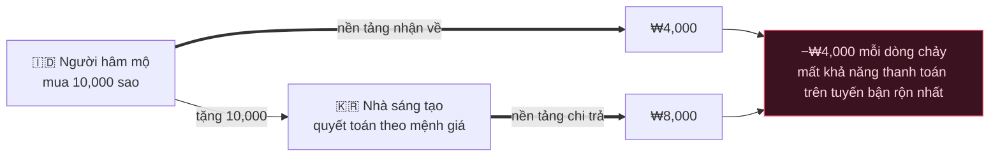
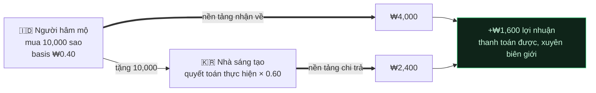

[🇺🇸 English](README.md) · [🇰🇷 한국어](README.ko.md) · [🇯🇵 日本語](README.ja.md) · [🇨🇳 简体中文](README.zh.md) · [🇹🇼 繁體中文](README.zh-TW.md) · [🇹🇭 ไทย](README.th.md) · [🇮🇩 Bahasa](README.id.md) · [🇻🇳 Tiếng Việt](README.vi.md)

# Gift Economy Settlement

**Sẽ ra sao nếu một món quà được mua với giá $0.30 ở Jakarta và được một nhà sáng tạo ở Seoul rút tiền mặt mà chẳng tốn của bạn một xu nào?**

> Được sử dụng bởi [**NSKit**](https://github.com/nskit-io/nskit-io) — *bị ràng buộc bởi cấu trúc, tự do trong kết hợp.* Đây là mô hình quyết toán đằng sau **byeol**, một nền tảng phát trực tiếp toàn cầu nơi người hâm mộ ở các thị trường mới nổi ủng hộ các nhà sáng tạo trên khắp thế giới.

> Bán đồng tiền của bạn theo giá địa phương. Trả cho nhà sáng tạo từ doanh thu thực. Duy trì khả năng thanh toán ở mọi biên giới.

**Gift Economy Settlement** là một mẫu thiết kế (design pattern) — kèm theo một bản triển khai tham chiếu — cho mô hình dòng tiền của bất kỳ nền tảng nào bán một loại tiền ảo trên phạm vi toàn cầu và trả cho các nhà sáng tạo từ đó: tiền tip phát trực tiếp, tặng quà của người hâm mộ, tiền tệ trong trò chơi, chi trả cho nhà sáng tạo. Đây không phải là một thư viện. Nó là một mẫu hình mà bạn có thể chuyển vào bất kỳ stack nào.

---

## Mục lục

- [Cái bẫy: vào rẻ, ra đắt](#cái-bẫy-vào-rẻ-ra-đắt)
- [Vì sao các giải pháp hiển nhiên lại phá sản](#vì-sao-các-giải-pháp-hiển-nhiên-lại-phá-sản)
- [Mô hình: quyết toán theo giá trị thực hiện](#mô-hình-quyết-toán-theo-giá-trị-thực-hiện)
- [Khả năng thanh toán, đã được chứng minh](#khả-năng-thanh-toán-đã-được-chứng-minh)
- [Hai loại tiền: trả phí và miễn phí](#hai-loại-tiền-trả-phí-và-miễn-phí)
- [Minh bạch: sổ cái FIFO](#minh-bạch-sổ-cái-fifo)
- [Mã tham chiếu](#mã-tham-chiếu)
- [Đánh đổi & khi nào nên dùng](#đánh-đổi--khi-nào-nên-dùng)
- [Liên kết](#liên-kết)

---

## Cái bẫy: vào rẻ, ra đắt

Mọi nền tảng tặng quà đều bán một loại tiền ảo — sao, xu, đá quý — mà người hâm mộ chi tiêu để ủng hộ các nhà sáng tạo, và các nhà sáng tạo rút tiền mặt. Khi vươn ra toàn cầu, hai lực lượng va chạm nhau.

**1. Ngang giá sức mua (PPP).** Để giành người dùng ở các thị trường mới nổi, đồng tiền phải *rẻ ở đó*. Một ngôi sao bán với giá $0.01 ở Mỹ không thể bán với giá $0.01 ở Indonesia — sẽ chẳng ai mua. App store hỗ trợ định giá theo từng lãnh thổ chính vì lý do này, và bạn phải sử dụng nó.

**2. Chi trả cho nhà sáng tạo.** Các nhà sáng tạo mong đợi *tiền mặt có ý nghĩa* cho đồng tiền mà họ nhận được.

Giờ hãy quyết toán chi trả cho nhà sáng tạo theo **mệnh giá** của đồng tiền (1 sao = 1 đơn vị) trong khi bán ngôi sao đó theo giá đã điều chỉnh PPP, và các dòng tiền xuyên biên giới sẽ âm thầm bào mòn bạn đến kiệt quệ.

Và trong cấu trúc quan trọng nhất — các fandom toàn cầu, nội dung K-content, khán giả kiều bào — dòng chảy nguy hiểm không phải là ngoại lệ, nó chính là **thông lệ**:

> **Các nhà sáng tạo tập trung ở những quốc gia chi phí cao. Người hâm mộ tập trung ở những quốc gia chi phí thấp.**

Một người hâm mộ mua sao với giá rẻ ở Jakarta và tặng chúng cho một nhà sáng tạo ở Seoul, người rút tiền mặt theo mệnh giá Seoul. Bạn thu về ít mà chi trả ra nhiều — trên chính tuyến đường bận rộn nhất của mình.

## Vì sao các giải pháp hiển nhiên lại phá sản

**Quyết toán theo mệnh giá cố định.** Trả `stars × fixed_rate`. Vào rẻ, ra đắt ⇒ lỗ trên dòng chảy chủ đạo. Mất khả năng thanh toán ở quy mô lớn.

**Quyết toán theo thị trường của nhà sáng tạo.** Nghe hấp dẫn — nhưng một nhà sáng tạo không thể kiểm soát nơi những người tặng quà cho họ đã mua tiền. Thị trường của người hâm mộ ≠ thị trường của nhà sáng tạo, nên khoản chi trả bị tách rời khỏi dòng tiền thực sự đã đi vào. Vẫn mất khả năng thanh toán.



Lỗi nằm ở tiền đề: **rằng một ngôi sao có một giá trị toàn cầu duy nhất.** Không phải vậy.

## Mô hình: quyết toán theo giá trị thực hiện

Hãy coi mệnh giá của đồng tiền là một **hư cấu để hiển thị**. Quyết toán dựa trên số tiền thực sự đã nhận được.

1. **Mỗi giao dịch mua đều ghi nhận doanh thu thực hiện** — số tiền nền tảng thực sự thu về sau các khoản phí store/PG, ở mức giá PPP địa phương.
2. **Mỗi ví mang một cost-basis pha trộn** — số tiền thực hiện trên mỗi đơn vị nắm giữ (`netReceived / unitsGranted`, được lấy trung bình).
3. **Tiền miễn phí/thưởng có cost-basis `0`** — nó chưa bao giờ được trả tiền, nên không bao giờ được quyết toán. Không rò rỉ. (Xem [hai loại tiền](#hai-loại-tiền-trả-phí-và-miễn-phí).)
4. **Một món quà chuyển giao cost-basis** từ ví của người hâm mộ sang sổ cái tích lũy của nhà sáng tạo.
5. **Quyết toán = Σ(số đơn vị trả phí nhận được × cost-basis của chúng) × tỷ lệ chi trả.**

Khoản chi trả của nhà sáng tạo giờ đây bám theo *giá trị thực của sự ủng hộ mà họ nhận được* — chứ không phải một con số mệnh giá. Một nhà sáng tạo ở Seoul với người hâm mộ Jakarta được trả từ doanh thu thực hiện tại Jakarta.

## Khả năng thanh toán, đã được chứng minh

Gọi $R$ = tổng doanh thu thực hiện đã thu về và $p$ = tỷ lệ chi trả, với $0 < p < 1$.

$$\text{platform margin} \;=\; R - R\cdot p \;=\; R\,(1-p) \;\ge\; 0$$

Vì khoản chi trả là một phần **của doanh thu thực hiện** (chứ không phải của mệnh giá), nền tảng luôn có khả năng thanh toán về mặt cấu trúc — **bất kể chênh lệch PPP hay sự pha trộn xuyên biên giới ra sao.** Dòng chảy làn sóng Hàn nguy hiểm giờ đây tạo ra lợi nhuận dương:



Cùng một dòng chảy đã làm phá sản các mô hình ngây thơ giờ đây lại kiếm ra lợi nhuận.

## Hai loại tiền: trả phí và miễn phí

Chia đồng tiền thành **trả phí** (đã mua, mang cost-basis) và **miễn phí** (thưởng/sự kiện, cost-basis `0`). Chi tiêu miễn phí trước, trả phí sau.

- Tiền miễn phí cho phép bạn triển khai các chương trình thưởng hào phóng và giữ chân người dùng mà không bao giờ tạo ra một khoản nợ quyết toán — một đơn vị miễn phí được tặng đi vốn dĩ không thể rút thành tiền mặt theo thiết kế.
- Chỉ phần trả phí của một món quà mới tích lũy vào số dư có thể quyết toán của nhà sáng tạo. Sự phân tách này tự động sinh ra từ phép tính cost-basis đối với tiền miễn phí (`0`).

## Minh bạch: sổ cái FIFO

Các khoản tích lũy xếp chồng theo thứ tự thời gian. Một khoản chi trả tiêu thụ **các khoản tích lũy cũ nhất trước (FIFO)**. Hãy công khai sổ cái đó cho nhà sáng tạo: với bất kỳ lần rút tiền nào, họ thấy chính xác những món quà nào cấu thành nên nó và giá trị thực hiện của từng món.

| Thời điểm | Từ | Sao trả phí | Chi trả |
|---|---|--:|--:|
| 07‑18 | @stella | 5,000 | ₩4,000 |
| 07‑19 | @captain | 12,000 | ₩9,600 |
| 07‑20 | @onedayfan | 3,000 | ₩2,400 |
| 07‑21 | @lastcall | 8,000 | ₩6,400 |
| | | | **₩22,400** ✓ = tổng chi trả |

Sự tin cậy là một tính năng. "Bạn đã nhận được 100,000 sao, đây là cách chính xác nó trở thành tiền mặt" thắng thế trước một con số mờ đục duy nhất.

## Mã tham chiếu

TypeScript độc lập với framework trong [`src/`](src/) — không phụ thuộc, chuyển nó đi đâu cũng được.

```ts
import { Wallet, SettlementEngine } from "./src";

// Một thị trường bán sao với giá đã điều chỉnh PPP; nền tảng thu về KRW thực hiện.
const fan = new Wallet();
fan.credit(10_000, /* realizedKrw */ 4_000);   // cost-basis 0.40/sao (Indonesia)
fan.creditFree(2_000);                          // thưởng — cost-basis 0

const engine = new SettlementEngine({ payoutRatio: 0.60 });
const gift = fan.spend(6_000);                  // miễn phí trước, rồi đến trả phí
engine.accrue(creatorId, gift);                 // chỉ phần trả phí, theo cost-basis của nó

const quote = engine.available(creatorId);      // thực hiện × tỷ lệ — luôn ≤ thực hiện
const ledger = engine.ledger(creatorId);        // phân tách FIFO, đối chiếu khớp với quote
```

Chạy kịch bản làn sóng Hàn đã tính toán sẵn và bài kiểm tra khả năng thanh toán:

```bash
npm install && npm test        # khẳng định lợi nhuận nền tảng ≥ 0 qua các dòng chảy xuyên biên giới ngẫu nhiên
npx tsx examples/k-wave.ts     # in ra dòng chảy Jakarta → Seoul
```

## Đánh đổi & khi nào nên dùng

- **Khoản chi trả cho nhà sáng tạo biến động theo cơ cấu người tặng** — một nhà sáng tạo với người hâm mộ giá trị cao kiếm được nhiều hơn trên mỗi ngôi sao so với một nhà sáng tạo có người hâm mộ ở thị trường mới nổi. Đây là một tính năng: *thu nhập phản ánh giá trị thực của sự ủng hộ.* Hãy làm cho nó minh bạch (sổ cái FIFO) để nó được nhìn nhận là công bằng, chứ không tùy tiện.
- **Trợ cấp giai đoạn tăng trưởng là một nút vặn, không phải mặc định.** Bạn *có thể* chọn bù thêm cho các khoản chi trả ở thị trường mới nổi để gây dựng một thị trường — nhưng hãy làm điều đó như một chi phí rõ ràng, có ngân sách, chứ không phải một cách vô tình thông qua quyết toán theo mệnh giá.
- **PPP thuộc về dữ liệu, không thuộc về mã.** Hãy giữ các hệ số nhân theo từng thị trường và tình trạng khả dụng của store dưới dạng một bảng hạng nhất mà bạn có thể tinh chỉnh mà không cần triển khai lại.
- **Hãy dùng cách này khi** bạn bán một loại tiền qua các thị trường có sức mua khác nhau và trả cho nhà sáng tạo từ đó. **Bỏ qua nó khi** bạn vận hành một thị trường duy nhất, hoặc các nhà sáng tạo được bạn trả trực tiếp (không phải từ một quỹ chung có thể thay thế lẫn nhau).

## Liên kết

- [**NSKit**](https://github.com/nskit-io/nskit-io) — nền tảng mà mẫu hình này vận hành
- Được xây dựng bởi [Neoulsoft Inc.](https://neoulsoft.com) — Seoul, thành lập năm 2019

## Giấy phép

MIT © Neoulsoft Inc. Xem [LICENSE](LICENSE).
