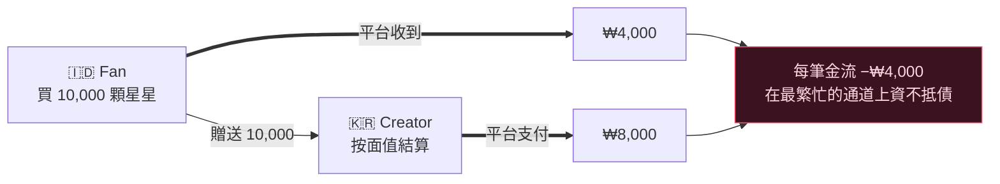
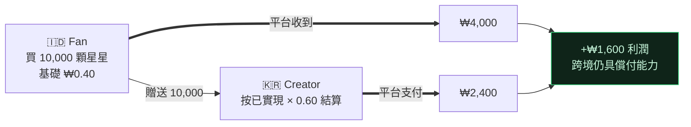

[🇺🇸 English](README.md) · [🇰🇷 한국어](README.ko.md) · [🇯🇵 日本語](README.ja.md) · [🇨🇳 简体中文](README.zh.md) · [🇹🇼 繁體中文](README.zh-TW.md) · [🇹🇭 ไทย](README.th.md) · [🇮🇩 Bahasa](README.id.md) · [🇻🇳 Tiếng Việt](README.vi.md)

# Gift Economy Settlement

**如果一份在雅加達以 0.30 美元購買的禮物，被首爾的一位創作者兌現，卻不用花你一毛錢，會是什麼樣子？**

> 由 [**NSKit**](https://github.com/nskit-io/nskit-io) 採用 — *受結構約束，自由組合。* 這正是 **byeol** 背後的結算模型，byeol 是一個全球直播平台，讓新興市場的粉絲能夠支持世界各地的創作者。

> 以在地價格出售你的貨幣。用真實營收支付創作者。在每一道國界之間保持償付能力。

**Gift Economy Settlement** 是一種設計模式 —— 並附帶參考實作 —— 用於任何在全球出售虛擬貨幣並以之支付創作者的平台的金流模型：直播打賞、粉絲贈禮、遊戲內貨幣、創作者分潤。這不是一個函式庫，而是一種你可以移植到任何技術堆疊中的模式。

---

## 目錄

- [陷阱：進來便宜，出去昂貴](#陷阱進來便宜出去昂貴)
- [為什麼那些顯而易見的修法會走向破產](#為什麼那些顯而易見的修法會走向破產)
- [模型：已實現價值結算](#模型已實現價值結算)
- [償付能力，可證明](#償付能力可證明)
- [兩種貨幣：付費與免費](#兩種貨幣付費與免費)
- [透明度：FIFO 帳本](#透明度fifo-帳本)
- [參考程式碼](#參考程式碼)
- [取捨與適用時機](#取捨與適用時機)
- [連結](#連結)

---

## 陷阱：進來便宜，出去昂貴

每個贈禮平台都會出售一種虛擬貨幣 —— 星星、金幣、寶石 —— 粉絲用它來支持創作者，創作者再將其兌現。走向全球後，兩股力量便會發生衝突。

**1. 購買力平價（PPP）。** 要在新興市場贏得使用者，這種貨幣在當地必須*便宜*。一顆在美國賣 0.01 美元的星星，在印尼不可能也賣 0.01 美元 —— 沒人會買。應用程式商店正是為此支援分地區定價，而你必須善用它。

**2. 創作者分潤。** 創作者期望他們收到的貨幣能換到*有意義的現金*。

如今若以貨幣的**面值**（1 顆星星 = 1 單位）結算創作者分潤，同時卻以 PPP 調整後的價格出售那顆星星，跨境金流便會悄悄把你榨乾。

而在最關鍵的結構中 —— 全球粉絲圈、K-content、離散族群的閱聽眾 —— 這種危險的金流並非例外，而是**常態**：

> **創作者聚集在高成本國家。粉絲聚集在低成本國家。**

一位粉絲在雅加達便宜地買下星星，贈送給首爾的一位創作者，而該創作者以首爾的面值兌現。你收得少、付得多 —— 而且是在你最繁忙的通道上。

## 為什麼那些顯而易見的修法會走向破產

**固定面值結算。** 支付 `stars × fixed_rate`。進來便宜、出去昂貴 ⇒ 在主流金流上虧損。規模化後就會資不抵債。

**按創作者的市場結算。** 很誘人 —— 但創作者無法控制他們的贊助者在哪裡購買。粉絲市場 ≠ 創作者市場，因此分潤與實際進帳的金錢脫鉤。仍然資不抵債。



錯誤出在前提上：**星星有一個全球通用的價值。** 它並沒有。

## 模型：已實現價值結算

把貨幣的面值當作一種**展示用的虛構**。以實際收到的金錢來結算。

1. **每一筆購買都記錄已實現營收** —— 平台在扣除商店／金流手續費後、以在地 PPP 價格實際淨得的金額。
2. **每個錢包都帶有一個混合的成本基礎** —— 每持有單位所對應的已實現貨幣（`netReceived / unitsGranted`，取平均）。
3. **免費／贈送的貨幣成本基礎為 `0`** —— 它從未被付費購買，因此永遠不會結算。沒有漏損。（見[兩種貨幣](#兩種貨幣付費與免費)。）
4. **一份禮物會轉移成本基礎**，從粉絲的錢包轉移到創作者的應計帳本。
5. **結算 = Σ(收到的付費單位 × 其成本基礎) × 分潤比例。**

創作者的分潤現在會追蹤*他們所收到支持的真實價值* —— 而非一個面值數字。一位擁有雅加達粉絲的首爾創作者，是從雅加達已實現的營收中獲得支付。

## 償付能力，可證明

設 $R$ = 已入帳的已實現營收總額，$p$ = 分潤比例，其中 $0 < p < 1$。

$$\text{platform margin} \;=\; R - R\cdot p \;=\; R\,(1-p) \;\ge\; 0$$

因為分潤是**已實現營收**的一個比例（而非面值的比例），平台在結構上就具備償付能力 —— **無論 PPP 價差或跨境組合如何。** 那道危險的韓流金流如今淨為正：



同一道曾讓天真模型破產的金流，如今賺取了利潤。

## 兩種貨幣：付費與免費

把貨幣拆分為**付費**（購買而來，帶有成本基礎）與**免費**（贈送／活動，成本基礎為 `0`）。先花免費、後花付費。

- 免費貨幣讓你能推出慷慨的贈禮與留存活動，而永遠不會產生結算負債 —— 一個被贈送出去的免費單位，在設計上就是無法兌現的。
- 只有禮物中的付費部分會累積到創作者可結算的餘額。這種拆分會從免費部分（`0`）的成本基礎運算中自動導出。

## 透明度：FIFO 帳本

應計項目依時間順序堆疊。一筆分潤會**先消耗最舊的應計項目（FIFO）**。把這個帳本呈現給創作者：對於任何一筆提領，他們都能確切看到是哪些禮物組成了它，以及每一份的已實現價值。

| 時間 | 來自 | 付費星星 | 分潤 |
|---|---|--:|--:|
| 07‑18 | @stella | 5,000 | ₩4,000 |
| 07‑19 | @captain | 12,000 | ₩9,600 |
| 07‑20 | @onedayfan | 3,000 | ₩2,400 |
| 07‑21 | @lastcall | 8,000 | ₩6,400 |
| | | | **₩22,400** ✓ = 分潤總額 |

信任是一項功能。「你收到了 100,000 顆星星，這是它如何精確地變成現金」勝過一個不透明的數字。

## 參考程式碼

框架無關的 TypeScript，位於 [`src/`](src/) —— 無相依套件，可移植到任何地方。

```ts
import { Wallet, SettlementEngine } from "./src";

// 某個市場以 PPP 調整後的價格出售星星；平台入帳已實現的韓元（KRW）。
const fan = new Wallet();
fan.credit(10_000, /* realizedKrw */ 4_000);   // 成本基礎 0.40/顆星星（印尼）
fan.creditFree(2_000);                          // 贈送 — 成本基礎 0

const engine = new SettlementEngine({ payoutRatio: 0.60 });
const gift = fan.spend(6_000);                  // 先免費，再付費
engine.accrue(creatorId, gift);                 // 只計付費部分，以其基礎計算

const quote = engine.available(creatorId);      // 已實現 × 比例 — 永遠 ≤ 已實現
const ledger = engine.ledger(creatorId);        // FIFO 明細，與報價相符
```

執行完整的韓流情境與償付能力測試：

```bash
npm install && npm test        # 驗證跨境隨機金流下平台利潤 ≥ 0
npx tsx examples/k-wave.ts     # 印出雅加達 → 首爾的金流
```

## 取捨與適用時機

- **創作者分潤會隨贊助者組合而變動** —— 一位擁有高價值粉絲的創作者，每顆星星賺得比擁有新興市場粉絲的創作者多。這是一項特色：*收入反映了支持的真實價值。* 讓它透明（FIFO 帳本），使它讀起來公平，而非任意。
- **成長期補貼是一個旋鈕，而非預設。** 你*可以*選擇為新興市場的分潤加碼，以扶植一個市場 —— 但要把它當作一項明確、有預算的成本，而不是透過面值結算意外產生。
- **PPP 屬於資料，而非程式碼。** 把各市場的乘數與商店可用性維護為一張一等的資料表，讓你無需部署就能調校。
- **在以下情況使用它**：你在購買力不同的多個市場中出售單一貨幣，並以之支付創作者。**在以下情況略過它**：你只經營單一市場，或創作者是由你直接支付（而非來自一個可互換的資金池）。

## 連結

- [**NSKit**](https://github.com/nskit-io/nskit-io) —— 這個模式所驅動的平台
- 由 [Neoulsoft Inc.](https://neoulsoft.com) 打造 —— 首爾，創立於 2019 年

## 授權條款

MIT © Neoulsoft Inc. 見 [LICENSE](LICENSE)。
