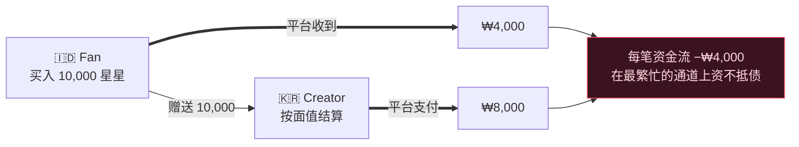
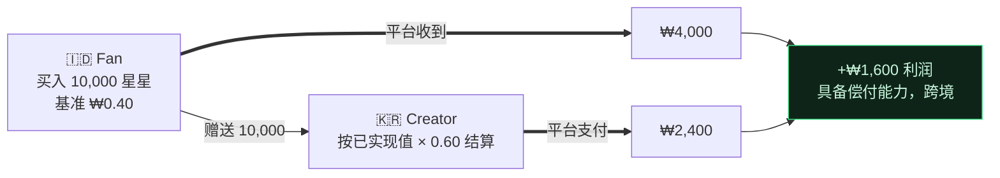

[🇺🇸 English](README.md) · [🇰🇷 한국어](README.ko.md) · [🇯🇵 日本語](README.ja.md) · [🇨🇳 简体中文](README.zh.md) · [🇹🇼 繁體中文](README.zh-TW.md) · [🇹🇭 ไทย](README.th.md) · [🇮🇩 Bahasa](README.id.md) · [🇻🇳 Tiếng Việt](README.vi.md)

# Gift Economy Settlement

**如果一份在雅加达以 0.30 美元购买、并由首尔的创作者兑现的礼物，从未让你花掉一分钱，会怎样？**

> 由 [**NSKit**](https://github.com/nskit-io/nskit-io) 使用 —— *受结构约束，自由组合。* 这是为 **byeol** 设计的结算模型（尚未投入生产），byeol 是一个全球直播平台，新兴市场的粉丝在这里支持世界各地的创作者。

> 以本地价格出售你的货币。用真实收入向创作者付款。在每一道国界之间保持偿付能力。

**Gift Economy Settlement** 是一种设计模式 —— 附带参考实现 —— 面向任何在全球范围内销售虚拟货币并以此向创作者付款的平台的资金模型：直播打赏、粉丝送礼、游戏内货币、创作者分成。这不是一个库，而是一种你可以移植到任何技术栈的模式。

---

## 目录

- [陷阱：进得便宜，出得昂贵](#陷阱进得便宜出得昂贵)
- [为什么那些显而易见的方案会破产](#为什么那些显而易见的方案会破产)
- [模型：已实现价值结算](#模型已实现价值结算)
- [偿付能力，已被证明](#偿付能力已被证明)
- [两种货币：付费与免费](#两种货币付费与免费)
- [透明度：FIFO 账本](#透明度fifo-账本)
- [参考代码](#参考代码)
- [权衡取舍与适用场景](#权衡取舍与适用场景)
- [链接](#链接)

---

## 陷阱：进得便宜，出得昂贵

每一个送礼平台都会销售一种虚拟货币 —— 星星、金币、宝石 —— 粉丝用它来支持创作者，而创作者将其兑现。一旦走向全球，两股力量便会碰撞。

**1. 购买力平价（PPP）。** 要在新兴市场赢得用户，货币在*那里必须便宜*。一颗在美国卖 0.01 美元的星星，不能在印度尼西亚也卖 0.01 美元 —— 没人会买。应用商店正是出于这个原因支持按地区定价，而你必须使用它。

**2. 创作者分成。** 创作者期望以其收到的货币换取*有意义的现金*。

如今，若按货币的**面值**（1 星 = 1 单位）结算创作者分成，同时以经 PPP 调整的价格销售那颗星星，跨境资金流便会悄悄把你榨干。

而在最要紧的结构中 —— 全球粉丝群、K 内容、离散族群受众 —— 那道危险的资金流并非例外，而是**常态**：

> **创作者聚集在高成本国家。粉丝聚集在低成本国家。**

一位粉丝在雅加达以低价购买星星，赠送给首尔的一位创作者，而后者以首尔面值兑现。你收进的少，付出的多 —— 就发生在你最繁忙的通道上。

## 为什么那些显而易见的方案会破产

**面值统一结算。** 按 `stars × fixed_rate` 支付。进得便宜、出得昂贵 ⇒ 在主导资金流上亏损。规模化后即资不抵债。

**按创作者所在市场结算。** 很诱人 —— 但创作者无法控制其捐赠者从何处购买。粉丝市场 ≠ 创作者市场，因此分成与实际进账的资金脱钩。依然资不抵债。



问题出在前提上：**认为一颗星星拥有单一的全球价值。** 事实并非如此。

## 模型：已实现价值结算

把货币的面值视为一种**显示层的虚构**。按实际收到的资金进行结算。

1. **每一笔购买都记录已实现收入** —— 即平台在扣除商店/支付渠道手续费后、按本地 PPP 价格实际净得的金额。
2. **每个钱包携带一个混合成本基准** —— 每持有单位所对应的已实现货币（`netReceived / unitsGranted`，取平均）。
3. **免费/赠送货币的成本基准为 `0`** —— 它从未被付费购买，因此永不参与结算。零泄漏。（参见[两种货币](#两种货币付费与免费)。）
4. **一份礼物会转移成本基准**，从粉丝的钱包转到创作者的应计账本。
5. **结算 = Σ(收到的付费单位数 × 其成本基准) × 分成比例。**

创作者的分成如今追踪的是*他们所收到支持的真实价值* —— 而非一个面值数字。一位拥有雅加达粉丝的首尔创作者，其分成来自雅加达已实现的收入。

## 偿付能力，已被证明

设 $R$ = 已入账的已实现收入总额，$p$ = 分成比例，其中 $0 < p < 1$。

$$\text{platform margin} \;=\; R - R\cdot p \;=\; R\,(1-p) \;\ge\; 0$$

由于分成是**已实现收入**的一部分（而非面值的一部分），平台在结构上即具备偿付能力 —— **无论 PPP 价差或跨境构成如何。** 那道危险的韩流资金流如今净值转正：



那道曾让幼稚模型破产的相同资金流，如今赚取利润。

## 两种货币：付费与免费

将货币拆分为**付费**（购买而来，携带成本基准）与**免费**（赠送/活动，成本基准为 `0`）。优先消费免费货币，其次消费付费货币。

- 免费货币让你可以运行慷慨的赠送与留存活动，而永远不会产生结算负债 —— 一个赠送出去的免费单位，按设计就是无法兑现的。
- 只有礼物中的付费部分才会累计到创作者的可结算余额。这种拆分会从免费货币成本基准为 `0` 的计算中自动得出。

## 透明度：FIFO 账本

应计款项按时间顺序堆叠。一次付款会**优先消耗最早的应计款项（FIFO）**。将该账本向创作者公开：对于任意一次提现，他们都能确切看到由哪些礼物构成，以及每一份的已实现价值。

| 时间 | 来自 | 付费星星 | 付款 |
|---|---|--:|--:|
| 07‑18 | @stella | 5,000 | ₩4,000 |
| 07‑19 | @captain | 12,000 | ₩9,600 |
| 07‑20 | @onedayfan | 3,000 | ₩2,400 |
| 07‑21 | @lastcall | 8,000 | ₩6,400 |
| | | | **₩22,400** ✓ = 付款总额 |

信任是一项功能。“你收到了 100,000 颗星星，这里是它如何精确地变成现金”胜过一个不透明的单一数字。

## 参考代码

[`src/`](src/) 中与框架无关的 TypeScript —— 无依赖，可移植到任何地方。

```ts
import { Wallet, SettlementEngine } from "./src";

// 某个市场以经 PPP 调整的价格出售星星；平台入账已实现的 KRW。
const fan = new Wallet();
fan.credit(10_000, /* realizedKrw */ 4_000);   // 成本基准 0.40/星（印度尼西亚）
fan.creditFree(2_000);                          // 赠送 —— 成本基准 0

const engine = new SettlementEngine({ payoutRatio: 0.60 });
const gift = fan.spend(6_000);                  // 优先免费，其次付费
engine.accrue(creatorId, gift);                 // 只有付费部分，按其基准

const quote = engine.available(creatorId);      // 已实现值 × 比例 —— 始终 ≤ 已实现值
const ledger = engine.ledger(creatorId);        // FIFO 明细，与报价对账一致
```

运行完整的韩流场景与偿付能力测试：

```bash
npm install && npm test        # 断言在随机跨境资金流下平台利润 ≥ 0
npx tsx examples/k-wave.ts     # 打印雅加达 → 首尔的资金流
```

## 权衡取舍与适用场景

- **创作者分成随捐赠者构成而变化** —— 拥有高价值粉丝的创作者，每颗星星赚取的收入高于拥有新兴市场粉丝的创作者。这是一项功能：*收入反映了支持的真实价值。* 让它透明（FIFO 账本），使其读起来公平，而非武断。
- **成长期补贴是一个可调旋钮，而非默认项。** 你*可以*选择补贴新兴市场的分成以培育某个市场 —— 但要将其作为明确的、有预算的成本来执行，而不是通过面值结算意外产生。
- **PPP 属于数据，而非代码。** 将各市场的乘数与商店可用性作为一张一等公民的表来维护，让你无需部署即可调整。
- **在以下情况使用它**：你跨越购买力不同的多个市场销售同一种货币，并以此向创作者付款。**在以下情况跳过它**：你只运营单一市场，或创作者由你直接付款（而非来自一个可互换的资金池）。

## 链接

- [**NSKit**](https://github.com/nskit-io/nskit-io) —— 由此模式驱动的平台
- 由 [Neoulsoft Inc.](https://neoulsoft.com) 打造 —— 首尔，成立于 2019 年

## License

MIT © Neoulsoft Inc. 参见 [LICENSE](LICENSE)。
